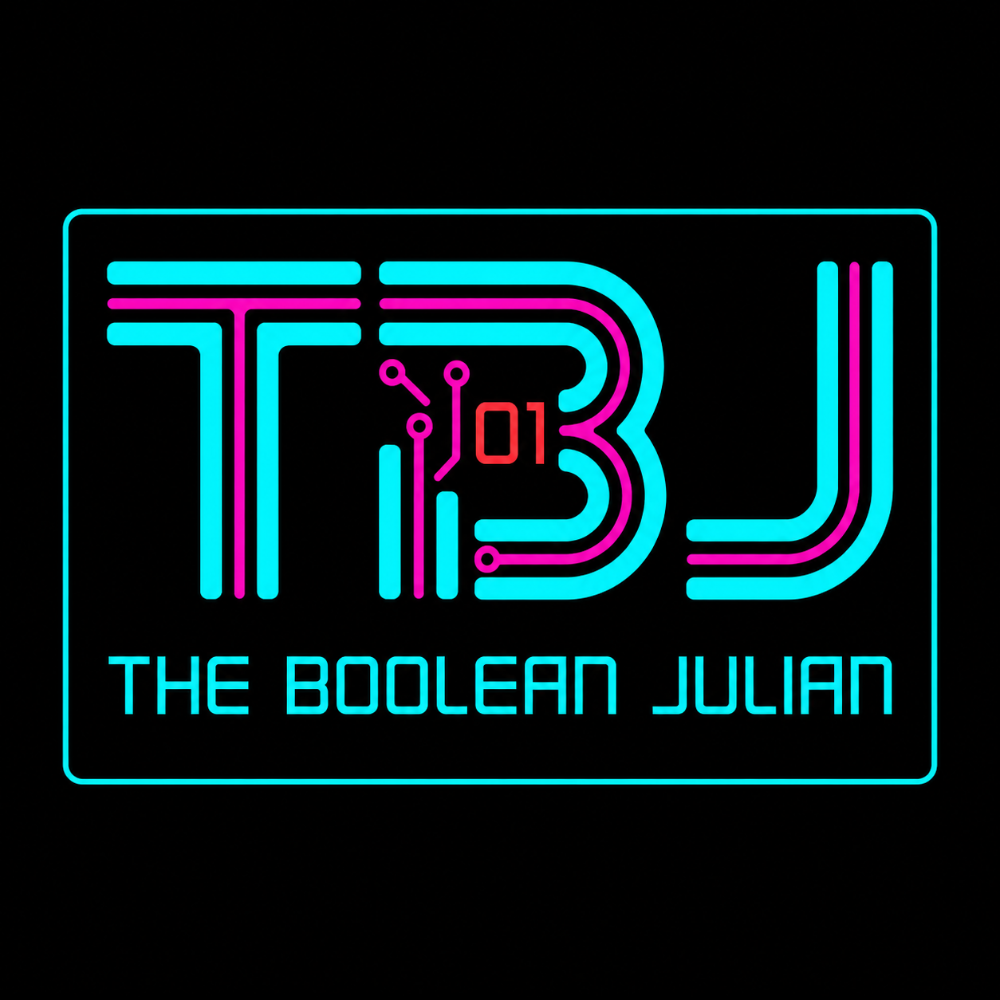

<div align="center">



# thebooleanjulian.github.io

**Personal landing page and live project showcase for TheBooleanJulian.**


</div>

---

## What it does

A GitHub Pages landing page for [@TheBooleanJulian](https://github.com/TheBooleanJulian) that dynamically fetches and displays public repositories via the GitHub API. Instead of a static list of projects, it pulls live repo data on load — so the showcase stays current without manual updates.

## Features

- Dynamic project showcase powered by the GitHub API (no manual list maintenance), auto-categorized by use case into selectable tabs
- Aperture XD-themed desktop: draggable-free windows with minimize/maximize/close and taskbar restore, a Start Menu, desktop icons, and a boot/shutdown screen
- 8 playable mini-games (Tic Tac Toe, Minesweeper, Battleship, Mancala, Blackjack, Solitaire, Chess, Pinball) plus MS Paint, Notepad, and a music visualizer
- JulianOS shell: virtual filesystem + Explorer, Internet Explorer, Command Prompt, Task Manager, Control Panel, Run dialog, context menus, notifications, achievements, saved window state and a mobile shell
- Reloads in the same tab skip the boot/login screens; add `?skip` (or `#skip`) to a link to go straight to the desktop
- No build step — plain HTML/CSS/JS, no bundler or framework
- Hosted on GitHub Pages at [thebooleanjulian.dev](https://thebooleanjulian.dev/) (behind Cloudflare)

## Tech Stack

| Layer | Choice |
|---|---|
| Frontend | Plain HTML/CSS/JS (`index.html`, one script per JulianOS app, `games.js`) and vendored [XP.css](https://botoxparty.github.io/XP.css/) |
| Data | GitHub REST API (client-side fetch, cached in `localStorage`) |
| Hosting | GitHub Pages, custom domain via `CNAME`, proxied by Cloudflare |

## Screenshots

_Screenshots coming soon — for now, visit the live site at [thebooleanjulian.dev](https://thebooleanjulian.dev/) to see it in action._

## Quick Start

No install needed. Clone the repo and open the file:

```bash
git clone https://github.com/TheBooleanJulian/thebooleanjulian.github.io
cd thebooleanjulian.github.io
open index.html
```

## Project Structure

```
thebooleanjulian.github.io/
|-- index.html          page, styles, project showcase, boot/login flow
|-- os.js               window manager + app registry
|-- shell.js            Start menu, Run dialog, context menus, keyboard shell
|-- fs.js, explorer.js  virtual filesystem + Explorer
|-- browser.js, cmd.js, taskmgr.js, controlpanel.js   JulianOS apps
|-- notifications.js, achievements.js, easter-eggs.js
|-- persist.js          saved window state
|-- games.js            mini-games, Paint, Notepad, media player
|-- favicon.ico, robots.txt, sitemap.xml, CNAME
|-- assets/
|   |-- xp.css          vendored XP.css v0.2.6 (dead @font-face rules removed)
|   |-- bliss.svg       wallpaper
|   |-- tbj-v2.png      full-size avatar (README only)
|   |-- tbj-512.png     link-preview image
|   |-- tbj-256.png     on-page avatar
|   `-- favicon-32.png
|-- LICENSE
|-- NOTICE
`-- COMMERCIAL-LICENSE.md
```

## Changelog

Versioned loosely as semver: **major** = a redesign or breaking change to how the site presents itself, **minor** = a new user-facing feature, **patch** = a fix to existing behavior.

- **v2.1.0** — *2026-11-26* — Skip boot/login on reload or with `?skip`; page through all repos (no 100 cap); remember README thumbnails per repo (about 450 requests per repeat visit down to about 13); fix homepage links missing `https://`; smaller avatar and favicon; meta description, Open Graph tags, sitemap and no-JS fallback; drop XP.css font rules whose files 404ed
- **v2.0.0** — *2026-09-01* — JulianOS: shared window manager, virtual filesystem + Explorer, Run dialog and context menus, Internet Explorer, session persistence, mobile shell, Command Prompt, Task Manager, Control Panel, notifications, achievements, easter eggs and an accessibility pass; XP branding renamed to Migusoft Aperture XD
- **v1.6.0** — *2026-07-24* — Categorize projects by persona (Bots & Automations, Games & Fun, Web Apps & Sites, Dev Tools & Scripts, Other) and present them as selectable tabs instead of one flat grid
- **v1.5.0** — *2026-07-20* — Add fork/open-issue stat badges, use each repo's README hero image as its card thumbnail (falling back to the GitHub auto-thumbnail, then the profile picture)
- **v1.4.0** — *2026-07-20* — Add bouncy diagonal guide walls to Pinball, higher-contrast Chess pieces, and MS Paint / Notepad / Windows Media Player-style visualizer apps
- **v1.3.1** — *2026-07-20* — Fix game windows shifting position on every re-render
- **v1.3.0** — *2026-07-20* — Add 8 classic mini-games (Tic Tac Toe, Minesweeper, Battleship, Mancala, Blackjack, Solitaire, Chess, Pinball) and pull the About Me bio/links from the live GitHub profile API
- **v1.2.0** — *2026-07-20* — Add the XP window manager (minimize/maximize/close, taskbar restore), Start Menu, desktop icons, boot/shutdown screen, project sort & language filters, and synthesized sound effects
- **v1.1.0** — *2026-07-20* — Add per-repo preview images and language icons to project cards
- **v1.0.0** — *2026-07-20* — Redesign the entire site as a Windows XP desktop
- **v0.3.0** — *2026-07-20* — Add a live-site link to project cards; add the custom domain (thebooleanjulian.dev); dual license under AGPLv3 + commercial
- **v0.2.1** — *2026-07-18* — Rewrite README and remove a stray `requirements.txt`
- **v0.2.0** — *2026-04-08* — Replace the hardcoded project list with a live GitHub API fetch; redesign the landing page around a dynamic project showcase
- **v0.1.0** — *2026-04-08* — Initial static landing page

## Status / Roadmap

- [x] Dynamic project showcase powered by the live GitHub API
- [x] Windows XP-themed desktop shell (windows, taskbar, Start Menu, boot/shutdown screen)
- [x] 8 playable mini-games plus MS Paint, Notepad, and a music visualizer
- [x] Persona-based project categorization tabs
- [x] Persistent window state across page reloads
- [x] Right-click context menus for the desktop and windows

## Future Roadmap

Ideas under consideration for future versions — not commitments, just where the project could reasonably go next:

- **Right-click context menus** — XP-style menus on the desktop and windows (Arrange Icons, Refresh, Properties) for more of the OS-parody novelty
- **Persistent window state** — remember which windows were open/minimized across a page reload, using `localStorage`
- **High scores per game** — local leaderboards for the mini-games (stored in `localStorage`), maybe with a shared "Achievements" desktop icon for milestones like "won every game once"
- **Resizable/draggable windows revisited** — a more careful implementation than the one reverted in v1.2.0, likely resize-only (no free dragging) with a min/max size clamp
- **Devlog/blog window** — a "Notepad"-styled journal fed from Markdown posts, versioned alongside this changelog
- **Theme switcher** — a "Display Properties" window to swap the desktop skin (e.g. Windows 98, Aero, a dark mode) instead of a single fixed XP theme
- **Contact form or guestbook** — styled like a retro mail client, backed by a serverless form service (no server to maintain)
- **Mobile experience pass** — right now several novelty elements (desktop icons, drag-to-resize ideas) intentionally hide below ~1080px; worth a dedicated pass at what "the desktop" should mean on a phone
- **Featured/pinned project spotlight** — a way to promote a specific repo to the top of its category regardless of sort order

## License

This project is dual licensed.

**Community Edition** — [GNU Affero General Public License v3 (AGPLv3)](LICENSE). Free to use, modify, and self-host. If you distribute a modified version or run it as a network service, you must make the corresponding source available.

**Commercial License** — for organisations that want to embed, modify, or distribute this software without AGPLv3's obligations. See [COMMERCIAL-LICENSE.md](COMMERCIAL-LICENSE.md).

---

<div align="center">
<sub>Built by <a href="https://github.com/TheBooleanJulian">@TheBooleanJulian</a></sub>
</div>